<p align="center">
  <picture>
    <source media="(prefers-color-scheme: dark)" srcset="docs/hero-dark.svg">
    
  </picture>
</p>

# Wobbli

An avatar that acts out what your AI agent is doing. It reads while an answer generates, celebrates when one lands, slumps when a source fails and tilts its head when a question is unclear: 39 states, five ways to act each, an optional mouth and hands, and 74 opt-in holiday costumes.

Try it and design your own in the studio at **[wobbli.dev](https://wobbli.dev)**. Built on [Blobatar](https://github.com/Alain00/blobatar) by Alain.

## Install

```sh
npm install wobbli      # or: pnpm add wobbli, bun add wobbli, yarn add wobbli
```

With shadcn/ui, add it as a component instead: `npx shadcn@latest add https://wobbli.dev/r/wobbli.json`.

Without a build step, load the web component from a CDN:

```html
<script type="module" src="https://cdn.jsdelivr.net/npm/wobbli@1/dist/element.js"></script>
<wobbli-avatar name="nova"></wobbli-avatar>
```

## React

```tsx
import { useRef } from "react";
import { Wobbli, type WobbliHandle } from "wobbli/react";
import "wobbli/styles.css";

const avatar = useRef<WobbliHandle>(null);

<Wobbli ref={avatar} name="nova" />

// as your agent works
avatar.current?.emit("message.sent");
avatar.current?.emit("tool.query");
avatar.current?.progress(0.42);
avatar.current?.emit("stream.end");
```

`<Wobbli>` renders a still frame on the server and starts the animation after hydration, so server and browser output match. With the shadcn registry: `npx shadcn@latest add https://wobbli.dev/r/wobbli.json`, then `import { Wobbli } from "@/components/wobbli"`.

## Plain HTML (web component)

```html
<script type="module">import "wobbli/element";</script>
<wobbli-avatar name="nova" size="40"></wobbli-avatar>
<script type="module">
  const el = document.querySelector("wobbli-avatar");
  el.emit("tool.search");
  el.addEventListener("statechange", e => console.log(e.detail.state, e.detail.kind));
</script>
```

Attributes are the props in kebab case (`eye-color`, `doze-after`, `lead-days`). Booleans take `"true"` or `"false"`; `traits`, `events`, `still-working` and `holidays` take JSON or can be set as properties. As properties they take objects or JSON strings, so React 19 (which sets props on custom elements as properties) and other frameworks can pass either.

## Any other framework

`wobbli/dom` mounts an avatar on any element (Vue, Svelte, Solid, plain JS):

```ts
import { mount } from "wobbli/dom";

const avatar = mount(document.querySelector("#bot")!, { name: "nova", size: 40 });
avatar.emit("tool.query");
avatar.update({ name: "nova", mouth: false });
avatar.destroy();
```

## The core, without a framework or a browser

```ts
import { look, render, createController } from "wobbli";

const l = look("nova");                       // generator 1: name (and pins) to a look
const html = render(l, "busy", "read");       // one still frame as HTML, in Node or a browser
const c = createController({ onStateChange: s => console.log(s) });
c.emit("tool.search");                        // the event-to-state machine, with an injectable clock
```

Nothing in the core touches `window` or `document` when imported.

`look(name).key` is a cache key and keeps the name as typed: `look("Nova")` and `look("nova")` draw the same avatar but have different keys.

## Props

Only `name` is required. The studio's generated code lists name, state and motion plus any prop that differs from these defaults.

| Prop | Default | Allowed |
| --- | --- | --- |
| `name` | Required | Any string, trimmed, up to 40 characters |
| `state` | `idle` | Any of the 39 states |
| `variant` | Random each time | One of the state's 5 variants |
| `shape`, `traits` | From the name | 10 shapes; each trait 0 to 1 |
| `color`, `eyeColor` | From the name | Hex |
| `mouth`, `hands` | `true` | Boolean |
| `styleFromName` | `false` | Boolean |
| `hair`, `hairColor`, `facialHair`, `eyebrows`, `clothes`, `clothesColor`, `glasses` | Not set | A set value overrides the name |
| `shadow` | `auto` | `auto`, `always`, `off` |
| `shadowColor` | Soft grey | `body` or hex |
| `shadowStrength` | 1 | 0.25 to 2 |
| `shadowAnimation` | `true` | Boolean |
| `motion` | `follow` | `none`, `hover`, `always`, `follow` |
| `speed` | 1 | 0.25 to 2 |
| `intensity` | 1 | 0 to 2 |
| `fidgets` | `sometimes` | `off`, `sometimes`, `often` |
| `dozeAfter` | 600 | 0 (never), 60, 300, 600 seconds |
| `holiday` | Off | `auto` or a holiday key |
| `region` | From the time zone | 14 regions; used with `holiday="auto"` |
| `leadDays` | 7 | 0, 3, 7 |
| `costume` | Random | One of the holiday's 5 costumes |
| `holidays` | All | `{ include?, exclude? }` by holiday key or kind (`civic`, `cultural`, `religious`, `seasonal`) |
| `events` | The event table | Any event to any state |
| `stillWorking` | `{ after: 20, state: "still", variant: "random" }` | 3 to 120 s, any state and variant |
| `size` | 28 px | Any CSS length |
| `theme` | `auto` | `auto`, `light`, `dark` |
| `announce` | `false` | Speak state changes through a polite live region, at most one every 5 s |
| `static` | `false` | One still frame and no controller (chat history) |
| `preload` | `false` | Load every state group up front, or the ones named |
| `controller` | Its own | A controller to follow, so several avatars show one agent (see below) |
| `controlled` | `false` | Show exactly `state`, `variant` and `progress`, with no timers |

## Methods and callback

On the React ref and the web component:

- `emit(event, value?)`: an app event (table below). Unknown names do nothing.
- `progress(value)`: 0 to 1, or `null` to clear.
- `setState(state, variant?)`: show a state directly; the timers below still apply.
- `getState()`: `{ state, variant, kind, note, progress }`.
- `onStateChange({ state, variant, kind, note, cause })`: `kind` is `pending`, `error`, `question` or `answer` (style your message bubble with it); `note` is the default text for error events; `cause` is the event name, `progress`, `still-working`, `back-to-idle`, `fidget`, `doze`, `wake` or `setState`.

## Events

| Event | Default state | Ends |
| --- | --- | --- |
| `message.sent` | busy | Next event |
| `stream.start` | write | Next event |
| `stream.end` | happy | Back to idle after the variant plays |
| `input.unclear` | curious | Next event |
| `tool.search`, `tool.query`, `tool.analyze`, `tool.build` | search, query, analyze, build | Next event |
| `tool.export`, `tool.import`, `tool.download`, `tool.upload`, `tool.sync`, `tool.connect` | export, import, download, upload, sync, connect | Next event |
| `approval.needed`, `input.needed`, `handoff`, `voice.start` | approval, waiting, handoff, listen | Next event |
| `instruction.ack` | gotit | Back to idle after 2.2 s |
| `session.start`, `session.end` | greet, bye | Back to idle after 2.8 s |
| `error.network`, `error.rate_limit` | offline, queued | Next event |
| `error.permission`, `error.no_results`, `error.unknown` | sad, sad, error | Next event |
| `progress` | busy (ring), or the state's own bar | — |

The last event wins. A working state that runs 20 s with no progress switches to "still working" once; idle fidgets now and then; after 10 minutes idle with no input it dozes off. The next input wakes it: a 1.2 s blink, then a greeting (input in the first 0.8 s after it dozes off is ignored). All durations divide by `speed`, every clock pauses while the tab is hidden, and reduced motion holds still frames while states and timers still apply. `speed` is also the playback rate of the animations; the short transitions between poses keep their length.

A controller you create with `createController()` and pass as `controller` runs on the avatars' shared ticker while at least one mounted avatar follows it: still working, fidgets, dozing and pausing while hidden all work, once per controller however many avatars follow it. An avatar going away never destroys it; call `destroy()` on it yourself. A controller with no mounted avatar has no ticker: call its `tick()` about every 400 ms, `input()` on user input and `setHidden()` when the page hides.

## Holidays

Off unless you ask: `holiday="auto"` dresses the avatar by date for `region`, `holiday="diwali"` always wears that holiday. Costume code loads only when a holiday is set, one region at a time. `wobbli/holidays` exposes the calendar (`holidayOn`, `upcoming`, `occurrences`, `detectRegion`). Holiday kinds are provisional until the cultural review.

## Theming and accessibility

- `--aa-ink`: outlines of props and costume parts (light on dark pages); `--aa-ink-dark` sets the dark value.
- `--aa-shadow-color`, `--aa-shadow-strength`: the ground shadow.
- `theme="auto"` follows the page: a `.dark` or `[data-theme="dark"]` ancestor, or a page whose `color-scheme` includes dark while the viewer prefers dark.
- Each avatar is `role="img"` with a label like "Avatar: Busy, read".
- Some props, costumes and effects (the Pride crown, Halloween hats, sparkles) draw outside the avatar's square. Leave some room around it, or clip with `overflow: hidden` on the host.

## Saved looks and share links

`wobbli/formats` reads and writes the studio's share links (`#studio~…`, format 2, with the generator number) and stored settings (format 3), and turns a look into props and code.

## The name contract

A name maps to one look, and that mapping (generator 1: Blobatar 2.7.0's geometry plus fixed style tables) is frozen for all of version 1. Golden fixtures for 64 names pin it in the test suite; a change that would alter any avatar ships as generator 2 in version 2.

## Contributing

Issues and pull requests are welcome, especially reviews of holiday costumes by people who celebrate them. See [CONTRIBUTING.md](CONTRIBUTING.md) and [docs/DESIGN.md](docs/DESIGN.md).

## Licence

MIT. Includes Blobatar 2.7.0, MIT licence, copyright (c) 2026 Alain: see [THIRD_PARTY_NOTICES.md](./THIRD_PARTY_NOTICES.md).
