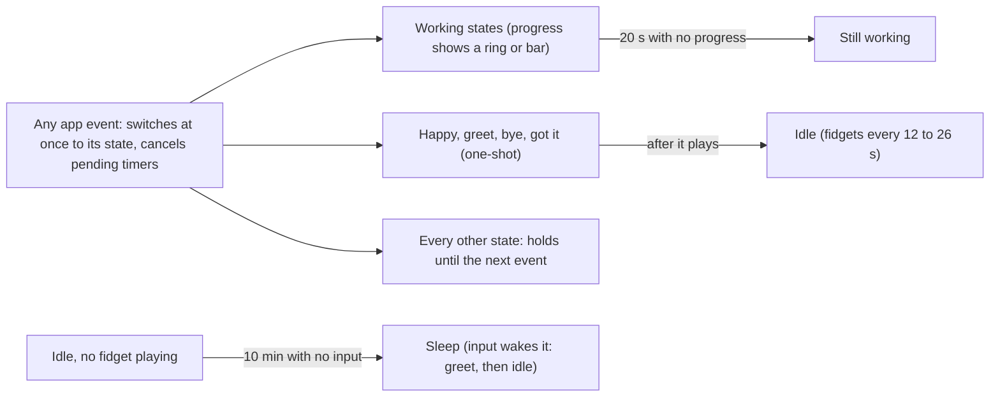
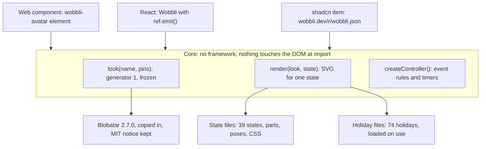

# Wobbli design

How Wobbli behaves and why: the rules the package keeps and the tests check. Written as the build brief for version 1; "the prototype" is the design prototype the package was built from.

## The name contract

A name maps to one look, and that mapping (generator 1) is frozen for the whole of package version 1. A change that would alter any avatar ships as generator 2 in package version 2, the same rule Blobatar uses.

**What generator 1 is**

- Blobatar 2.7.0's geometry, copied into the core: the body shape, the 10 shape bands, the traits, the eye frames and the colour palette.
- Our style tables: hair, hair colour, facial hair, eyebrows, clothes, clothes colour and glasses, each picked with an FNV-1a hash of `style:<key>:<name>` against fixed weights.
- Nothing else. States, poses, costumes and shadows are drawn on top and may improve in any release, because they do not change who the avatar is.

**Rules**

1. **The name is normalised.** Before hashing, the name is normalised the way Blobatar does it: Unicode NFC, trimmed, lower case. So "nova", "Nova" and " nova " are the same avatar, body and style alike. The prototype hashed the style from the raw name, so "Nova" got nova's body with different hair; that is fixed and published. The studio also caps names at 40 characters.
2. **No change within a major version.** The tables, weights and hashes are constants. A pull request that changes any golden fixture fails CI.
3. **No browser measuring.** The prototype measures the body's bounding box with the browser's `getBBox()`, which can differ slightly between browsers and does not exist on a server. The core computes it from the path maths instead, matching the fixtures to 0.01.
4. **Saved data names its generator.** Share links (`g`) and stored studio settings (`generator`) both carry the generator number, and the prototype writes it today. When a later package meets an older number, it renders that generator if it still ships it, and otherwise says so in the console instead of silently showing a different face.
5. **Pins sit on top.** A pinned trait, colour or style value overrides the name's choice and never feeds back into it.

**Golden fixtures.** `test/fixtures/generator-1.json` holds 64 names (short, long, case variants, email addresses, accented, Chinese, Korean, Hindi, Arabic, emoji) with their full output: 14 trait values at full precision, shape, body and eye colours, body path, eye paths and frames, bounding box and the style picks. They come from the prototype as it stands today, two runs produced identical output, and Blobatar 2.7.0 on its own in Node (no browser) reproduces all 64 trait sets. The core must reproduce them exactly, except the bounding box within 0.01.

## Defaults

Out of the box an avatar has a mouth and hands, follows the cursor with its eyes, fidgets now and then and wears no costume; its shape, colour and proportions come from its name. The prototype now uses these defaults, and the studio's generated code lists name, state and motion plus any prop that differs from them.

| Prop | Default | Allowed |
| --- | --- | --- |
| `name` | Required | Any string, trimmed, up to 40 characters |
| `state` | `idle` | Any of the 39 states |
| `variant` | Random each time | One of the state's 5 variants |
| `shape`, `traits` | From the name | 10 shapes; each trait 0 to 1 |
| `color` | From the name | Hex |
| `eyeColor` | From the name | Hex |
| `mouth` | `true` (was off) | Boolean |
| `hands` | `true` (was off) | Boolean |
| `styleFromName` | `false` | Boolean |
| `hair`, `hairColor`, `facialHair`, `eyebrows`, `clothes`, `clothesColor`, `glasses` | Not set | Options from the Style tab; a set value overrides the name |
| `shadow` | `auto` | `auto`, `always`, `off` |
| `shadowColor` | Soft grey | `body` or hex |
| `shadowStrength` | 1 | 0.25 to 2 |
| `shadowAnimation` | `true` | Boolean |
| `motion` | `follow` | `none`, `hover`, `always`, `follow` |
| `speed` | 1 | 0.25 to 2 |
| `intensity` | 1 | 0 to 2 |
| `fidgets` | `sometimes` | `off`, `sometimes`, `often` |
| `dozeAfter` | 600 s | 0 (never), 60, 300, 600 |
| `holiday` | Off (was by date) | `auto` or a holiday key |
| `region` | Detected from the time zone | 14 regions; used only with `holiday="auto"` |
| `leadDays` | 7 | 0, 3, 7 |
| `costume` | Random | One of the holiday's 5 costumes |
| `events` | The event table below | Any event to any state |
| `stillWorking` | After 20 s, state still, random variant | 3 to 120 s, any state and variant |
| `size` | 28 px in a chat | Any CSS length |

Looks saved in the studio before this change kept the old defaults as stored values. The studio now migrates them: a stored "mouth off", "hands off" or "holidays by date" from before is read as the new default.

## Holidays

No costume shows unless the app asks for one: `holiday="auto"` dresses the avatar by date for a region, and a holiday key pins one holiday. The studio now starts with holidays off, and the website's holiday sections stay as demos.

**Turning them on**

- `holiday` omitted: no costume. `holiday="auto"`: by date, using `region` (detected from the time zone, falling back to the United States) and `leadDays` (0, 3 or 7 days early). `holiday="diwali"`: always that holiday, with `costume` picking one of its five.
- New: `holidays={{ exclude: ["halloween", "religious"] }}` and `holidays={{ include: [...] }}` filter what auto may show, by holiday key or by kind.
- Each of the 74 holidays gets a kind: `civic`, `cultural`, `religious` or `seasonal`. One word then lets a work app skip every religious holiday. The prototype has no kinds yet; tagging them is part of the review below.

**Dates**

- Fixed dates (St Patrick's Day) and rule-based dates (Easter, the fourth Thursday in November) are computed and work for any year.
- Moon-based dates come from tables, and the tables run out soon: India's 17 festivals (including Holi, Diwali and both Eids) cover 2026 and 2027; China's and South Korea's cover 2026 to 2028. After that those holidays silently never show.
- Fill the tables through 2036 from official holiday lists, and add a test that fails when any table ends less than two years from today.
- Eid falls on the day the moon is sighted, so it can land a day either side of the listed date. Show its costume from the eve through the day after.

**Cultural review**

Before holidays ship, have someone who celebrates each one check its five costumes, and set its kind while they are at it. Start with the religious ones: Diwali, Holi, Maha Shivaratri, Navratri, Durga Puja, Dussehra, Janmashtami, Ganesh Chaturthi, Mahavir Jayanti, Vaisakhi, Guru Nanak's birthday, Buddha Purnima, Eid al-Fitr, Eid al-Adha, Easter, Christmas, Día de Muertos, Las Posadas, Día de Reyes, Obon and the saints' days (St Brigid, St Patrick, St Lucia, St Martin, St Nicholas). Anything a reviewer flags is fixed or dropped before release.

## Event to state rules

The avatar shows one state at a time: the app's last event picks it, and four timers move it on by themselves (back to idle, still working, idle fidgets, dozing off). This is the prototype's behaviour, written down so the package matches it exactly.

**Events and their default states.** Apps can remap any event to any state with the `events` prop.

| Event | Means | Default state | Ends |
| --- | --- | --- | --- |
| `message.sent` | The user sends a message | busy | Next event |
| `stream.start` | The answer starts streaming | write | Next event |
| `stream.end` | The answer is complete | happy | Back to idle after the variant plays |
| `input.unclear` | It needs clarification | curious | Next event |
| `tool.search` | Searching reports, data or the web | search | Next event |
| `tool.query` | Running a query | query | Next event |
| `tool.analyze` | Crunching the numbers | analyze | Next event |
| `tool.build` | Building a chart, report or deck | build | Next event |
| `tool.export` | Exporting a file | export | Next event |
| `tool.import` | Importing a file | import | Next event |
| `tool.download` | Downloading a file | download | Next event |
| `tool.upload` | Uploading a file | upload | Next event |
| `tool.sync` | Syncing a source | sync | Next event |
| `tool.connect` | Signing in to a source | connect | Next event |
| `approval.needed` | It needs a yes before it acts | approval | Next event |
| `input.needed` | It is the user's turn | waiting | Next event |
| `instruction.ack` | It takes a correction on board | gotit | Back to idle after 2.2 s |
| `handoff` | It passes work to someone else | handoff | Next event |
| `voice.start` | It listens to voice input | listen | Next event |
| `session.start` | A chat opens | greet | Back to idle after 2.8 s |
| `session.end` | A chat closes | bye | Back to idle after 2.8 s |
| `error.network` | The connection dropped | offline | Next event |
| `error.rate_limit` | Too many requests | queued | Next event |
| `error.permission` | Blocked by a permission | sad | Next event |
| `error.no_results` | Nothing came back | sad | Next event |
| `error.unknown` | Anything else that failed | error | Next event |
| `progress` | A value from 0 to 1, or null to clear | See rule 6 | — |

**Rules**

1. **Last event wins.** An event replaces the current state at once and cancels any pending timer (back to idle, still working). There is no queue and no priority between events. Unknown event names are ignored.
2. **Variants.** Each time a state starts, it picks one of its five variants at random, never the same one twice in a row. The `variant` prop pins one.
3. **Back to idle.** Happy returns to idle when its variant finishes: Double hop 1.6 s, Spin jump 1.95 s, Puff up 1.95 s, Ta-da 2.15 s, Dance 2.45 s. Greet and bye return after 2.8 s, got it after 2.2 s. Every other state holds until the next event. All durations divide by `speed`.
4. **Working states** are busy, the Moving data group (download, upload, sync, export, import) and the Working group (search, query, build, analyze, write, connect). Entering one starts the still-working clock.
5. **Still working.** If a working state runs for `stillWorking.after` seconds (default 20, allowed 3 to 120) with no progress showing, it switches to `stillWorking.state` (default still) and `stillWorking.variant` (default random). This happens once per working stretch; the next event resets it.
6. **Progress.** `progress` clamps its value to 0 to 1. If the current state has a progress variant (busy: ring, download: bar, query: bar), it switches to that variant; otherwise it switches to busy with the ring. Each value restarts the still-working clock, and while a value shows it never switches to still working. `null` clears the value.
7. **Message kind.** Each state reports a kind the host chat can style: working states are pending; sad, offline, queued, error and anger are error; curious is question; everything else is answer. Error events also carry a default note (for example, "I lost the connection to the data source. Trying again…").
8. **Idle fidgets.** Only in idle, only when motion is always or follow, never with reduced motion. With fidgets set to sometimes, one starts every 12 to 26 s; often, every 4.5 to 9 s. The pool is glance (2.8 s), stretch (2.4 s), blink twice (0.9 s), look up (2.6 s) and shuffle (2.0 s); after 60 s of idle, yawn (3.6 s) joins at double weight. Never the same fidget twice in a row. Any other state ends a fidget.
9. **Dozing off.** When `dozeAfter` is set (never, 60, 300 or 600 s; default 600) and the avatar has been idle with no fidget playing and no user input (pointer, key, wheel, touch) for that long, it switches to sleep with a random variant from nightcap, dream, snooze and lullaby.
10. **Waking up.** User input while asleep (after a 0.8 s grace period) plays the wake-up fidget (1.2 s), then greet (2.8 s), then idle. An app event while asleep ends sleep straight into that event's state, with no greeting.
11. **Hidden tab.** The clocks are checked every 400 ms, and not at all while the page is hidden. In the package, pause them while hidden and resume on return, so a returning user is not met by a doze that fired in the background.
12. **Reduced motion.** The loops hold a still frame and fidgets are off, but state changes and their timers still apply, so the avatar still shows what is happening.

An event always wins; the timers only act while no new event arrives.

## Package architecture

One core with no framework and no browser dependency does all the work (look, drawing, behaviour); a web component, a React wrapper and a shadcn item sit on top, and the avatar's parts become data files instead of being scraped from design boards.

Apps pick one entry point; all three call the same core, and holiday files load only when an app turns holidays on.

**Layers**

- **Core.** Three pure parts: `look(name, pins)` runs generator 1; `render(look, state, variant, options)` returns the SVG; `createController(options)` is the state machine from the rules above, with an injectable clock so tests control time. Nothing touches `window` or `document` at import.
- **Web component.** `<wobbli-avatar name="nova">` wires the core to the page for plain HTML and any framework.
- **React.** `<Wobbli>` with `ref.current.emit(...)`. It renders the still SVG on the server and starts the animation after hydration, so server and browser output match.
- **shadcn item.** A small React file at `wobbli.dev/r/wobbli.json` that imports the core.

**Parts as data, not scraped boards.** The prototype pulled the SVG parts out of its design canvas files. That extraction ran once (its output is in `data/`); the package keeps one file per state (variants, poses, parts, CSS) and one per holiday region (dates, costumes, CSS). Each file is reviewable in a pull request, and the canvas files and `build.py` retire.

**Bundle split.** The prototype ships everything at once: 183 KB compressed. Measured pieces, compressed:

| Piece | Size |
| --- | --- |
| Holiday costume parts (423 parts) | 35 KB |
| State CSS | 23 KB |
| State parts (156 parts) | 10 KB |
| Holiday CSS | 9 KB |
| Blobatar geometry | 8 KB |

The main entry carries the core, Blobatar's geometry and the five chat states. The other five state groups load on first use, or up front with `preload`. Each holiday region loads only when `holiday` is set.

**Many avatars on a page**

- `static` draws one still frame and skips the controller: for chat history, where only the newest message should move.
- Avatars scrolled off screen pause (IntersectionObserver), and every avatar pauses while the tab is hidden. The prototype only pauses avatars on other pages of the site.
- One shared 400 ms ticker and one pointer listener serve all avatars, as in the prototype.

**Theming and accessibility**

- Documented CSS custom properties: `--aa-ink` (outlines on dark backgrounds, `--av-ink` today), `--aa-shadow-color`, `--aa-shadow-strength`; a `theme` prop (`auto`, `light`, `dark`).
- The SVG has `role="img"` and a label like "Avatar: Working, typing". An opt-in `announce` prop speaks state changes through a polite live region, at most one every 5 s, so screen readers are not flooded.
- Reduced motion holds still frames, as in rule 12.

**Versioned formats.** Share links carry `$` (format, now 2) and `g` (generator); stored settings carry `ver` (now 3) and `generator`. Readers accept older versions and ignore newer ones they do not understand, with a console warning.

## Public API

The props are the Defaults table above, the same names the studio already writes into its generated code; on top of them come four methods, one callback and two stored formats.

**Methods** (on the React ref and the web component)

- `emit(event, value?)`: send an app event from the table above. Unknown names do nothing.
- `progress(value)`: 0 to 1, or `null` to clear (rule 6).
- `setState(state, variant?)`: show a state directly, skipping the event map. It still follows rules 3 to 5.
- `getState()`: returns `{ state, variant, kind, note }`.

**Callback**

- `onStateChange({ state, variant, kind, note, cause })`, where `cause` is the event name, `progress`, `still-working`, `back-to-idle`, `fidget`, `doze` or `wake`. Host chats use `kind` to style the message bubble and `note` for the error text.

**Share link.** `#studio~` followed by base64url JSON with short keys. Format 2 (today) always writes `$`, `g`, `n`, `m` and `h`, and the rest only when it differs from the defaults:

| Key | Meaning |
| --- | --- |
| `$` | Format, 2. Missing means format 1, where mouth and hands were off unless `mo`/`hn` was 1. |
| `g` | Generator, 1 |
| `n`, `s`, `t` | Name, pinned shape, pinned traits (0 to 1000) |
| `c`, `cs`, `e` | Colour, `s` when it is a skin tone, eye colour (hex without #) |
| `mo`, `hn` | 0 when mouth or hands are off |
| `dr`, `hr`, `hc`, `bd`, `bw`, `cl`, `cc`, `gl` | Style from the name, then the style pins |
| `sh`, `sc`, `sk`, `sa` | Shadow: `w` always or `o` off; `b` body or hex; strength ×100; 0 when not animated |
| `m`, `p`, `i`, `z` | Motion (first letter), speed ×100, intensity ×100, chat size |
| `h`, `r`, `l`, `o` | Holiday (`a` by date, `-` off, or a key), region, lead days, costume |
| `x`, `v` | Live state and variant |
| `f`, `d`, `ev`, `w` | Fidgets, doze seconds, event remaps, still working `[after, state, variant]` |

**Stored settings.** The studio stores its look under `agent-avatar-studio:look:v2` with `ver` (3) and `generator` (1). Settings with no `ver` are migrated as described under Defaults.
